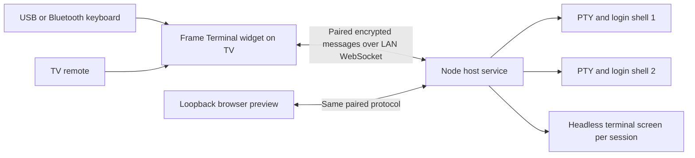

# Architecture

## Processes and trust boundaries

The TV widget has no host filesystem or shell access by itself. The Node service runs as the logged-in user and owns the processes. A paired client can issue terminal commands with that user's permissions. The preview is another paired client, served only on loopback.

## Session manager

`server/sessions.mjs` starts a login shell using `node-pty`. On macOS it defaults to zsh. Each PTY has an ID and a separate environment, working directory and process lifetime. The host caps sessions at eight. Input and terminal dimensions are validated before reaching the PTY.

An xterm headless instance parses output for each session, including sessions the TV isn't currently viewing. The serialize addon reconstructs that terminal state when a client attaches. That avoids replaying arbitrary old control sequences as the only recovery mechanism. Up to 2,000 scrollback lines are kept in memory per session; there is no transcript database.

PTY parsing uses pause/resume thresholds for backlog. A slow WebSocket viewer is disconnected when its queued output exceeds the configured threshold, then can reconnect and restore. A shell exit is shown in the terminal and retained in the session list until closed.

The shell environment is assembled from a small host-variable allowlist, including PATH, HOME and locale settings. It doesn't copy every variable from the service process. The shell's normal startup files still run and can load the user's own configuration or credentials.

## Connection and pairing

`scripts/frame-config.mjs` creates a static host keypair and one TV keypair. The host saves its private key and the allowed client public key. The widget gets the host public key and its own private key during the local build. Key files aren't in Git.

The handshake in `shared/crypto.mjs` works as follows:

1. The host sends a fresh random challenge for that WebSocket connection.
2. The client generates a fresh 32-byte symmetric key and separate 16-byte nonce prefixes for each direction.
3. The client sends the challenge, key and prefixes inside a NaCl public-key box addressed to the paired host.
4. The host checks the client public-key allowlist, opens the box and checks the challenge.
5. Both sides exchange JSON messages in authenticated secretboxes. Each direction has its own strictly increasing counter and nonce prefix.

A replayed handshake doesn't match a new challenge. Repeated, altered or out-of-order encrypted packets are rejected. The 24-byte message nonce contains the direction's 16-byte prefix, a little-endian 32-bit counter and four zero bytes. Counter exhaustion requires a fresh connection.

This is application-layer encryption over `ws://`, using TweetNaCl's box and secretbox implementations. It is a custom protocol with automated negative tests, not an independently audited transport or TLS connection. See [security limitations](../SECURITY.md), especially static-key compromise and lack of forward secrecy.

## Host endpoints

| Listener | Surface |
| --- | --- |
| Configured host IPv4 and port, default `4319` | `/health` returns a basic ready response; `/terminal` handles WebSocket upgrade |
| `127.0.0.1`, default `4320` | Local app preview, including generated client config |

The LAN HTTP listener doesn't serve widget assets, config or private keys. The WebSocket listener applies an address allowlist before pairing, an authentication deadline, an attempt limit, a connection limit and an incoming payload limit. `/health` reports that the service is available; it doesn't prove a particular TV is connected or a shell is usable.

Authenticated operations are create, list, attach, resize, input, rename and close. Input/resize are restricted to that client's active session. Closing a session invalidates viewers attached to it. Authentication never directly creates a shell; the client must request creation after pairing.

## Build and service

`scripts/build-frame-terminal.mjs` bundles browser code/CSS, copies the font and icon, writes private client settings, and generates the host origin in the manifest. Tizen tooling prepares and signs that directory separately.

`scripts/service.mjs` installs a user LaunchAgent with absolute Node and repository paths. The service calls `server/main.mjs`, binds the configured interfaces, and disposes PTYs on a graceful shutdown. No shell content is written to the service logs.

The root wrapper is separate from all of this. It isn't loaded into the host service or called from the terminal UI.
