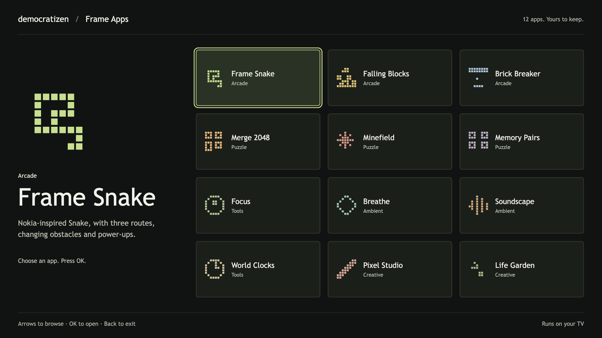
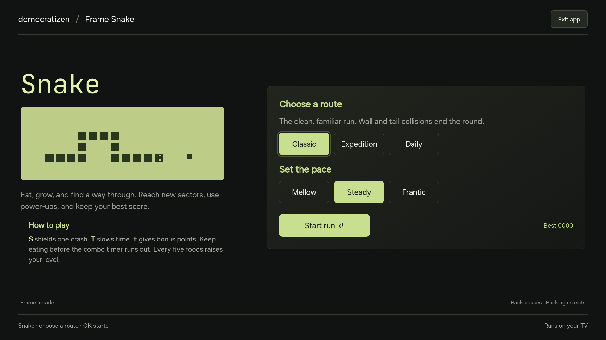
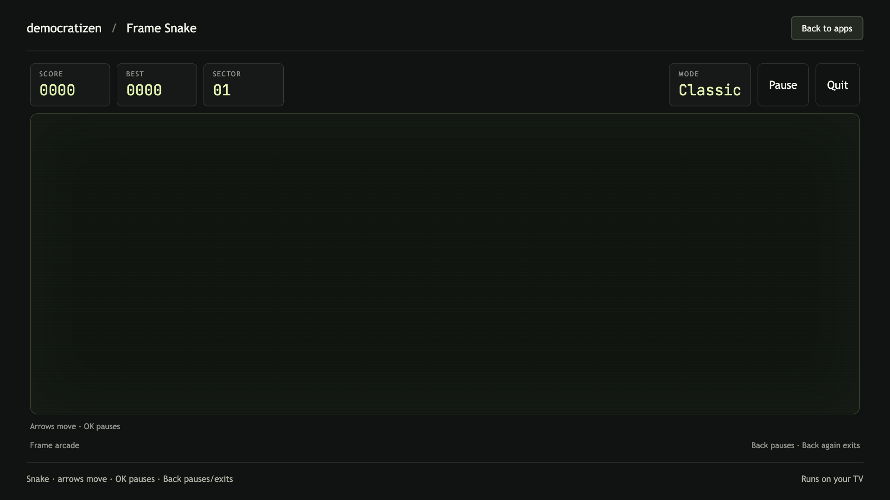

# Twelve standalone TV apps

The Frame Apps collection adds six games and six tools to democratizen. Each installs as its own Samsung TV widget. Every app runs locally after installation: no Mac companion, account, network service or root access is needed.



The browser library above is a preview and development tool. On the TV, open each app from Samsung's Apps screen.

## Build, preview and install

From the repository root, with the [prerequisites](prerequisites.md) installed:

```sh
npm ci
npm run suite:build
npm run suite:preview
```

Open `http://127.0.0.1:4396` in a browser. Use the arrow keys and Enter, or a mouse. A direct preview such as `http://127.0.0.1:4396/#snake` opens that app. Stop the preview server with Ctrl+C. Set `SUITE_PORT` if port 4396 is occupied.

For the TV, complete [Developer Mode](developer-mode.md) and [signing](signing.md), then run:

```sh
TV_IP=192.168.1.50 npm run suite:deploy -- all
```

Replace the example address with your TV's address. Existing local terminal setup supplies `TV_IP` when available. The deploy script uses the same `TIZEN_STUDIO_HOME`, `TIZEN_CLI`, `SDB` and `SAMSUNG_SIGNING_PROFILE` overrides as the other apps. The default signing profile is `StudyFramePublic`; use your own profile when deploying to another television.

Build or install one app by its slug:

```sh
npm run suite:build -- snake
TV_IP=192.168.1.50 npm run suite:deploy -- snake
```

A single-app build also rebuilds the browser library, which includes all twelve apps. Build output lives in `dist/frame-suite/<slug>/`; signed widgets are placed in each app's `.buildResult/` folder. These generated files and signing credentials are excluded from Git.

The install script signs, installs and launches every selected widget. It prints exact success and error counts, saves a local `dist/frame-suite/install-results.json`, and returns a failure exit status if any app fails. A full successful install leaves Frame Snake open.

To check the installed code through the TV’s web inspector:

```sh
npm run suite:verify -- all
```

This relaunches each selected app, checks its build ID, viewport and input handling, then saves `dist/frame-suite/runtime-results.json`. It restores the app’s saved data after its checks. Set `FRAME_SUITE_SCREENSHOTS=1` to save TV screenshots alongside the report. The verifier uses local ports 9400 onward temporarily and removes its forwards after each app.

## Remote controls

Arrows move the focus ring. **OK** activates the focused control. **Back** pauses a running game or exits a drawing mode; Back again opens the leave confirmation. Arrow navigation never changes a setting just because it has focus.

Sliders need **OK** to enter adjustment mode, **Left/Right** to change the value, then **OK** or **Back** to finish. A USB or Bluetooth keyboard uses the same arrows and Enter. Space or the remote's Play/Pause key pauses supported games and timers; every required action also has an on-screen control or a Back menu.

Games pause when the TV hides the app. Audio stops when Soundscape is hidden. Returning to an app does not automatically restart gameplay or audio.

| App | Slug | Main controls and behaviour |
| --- | --- | --- |
| Frame Snake | `snake` | Choose a mode and pace. Arrows steer; OK or Back pauses. The pause screen can resume, return to the Snake menu or leave. |
| Falling Blocks | `blocks` | Left/Right moves; Up rotates; Down lowers; OK drops the piece. Back pauses. A ghost piece shows the landing position. |
| Brick Breaker | `paddle` | Left/Right moves the paddle; OK serves the ball or pauses. Clear four rounds, with three lives and a new serve after each missed ball. |
| Merge 2048 | `merge` | Arrows slide. Back opens controls, including Undo. A valid saved board and its score can be continued on the next launch. |
| Minefield | `mines` | Arrows choose a cell; OK reveals it. Navigate to Flag mode or switch it from the Back menu to mark mines. The first reveal and its neighbours are safe. |
| Memory Pairs | `pairs` | Arrows choose a card; OK turns it over. Match all eight pairs. Timing starts on the first turn and excludes pauses. |
| Focus | `focus` | Choose work or break, adjust the lengths, then Start. The timer uses a deadline to handle delayed frames. Completed work sessions are counted for the TV's local day. |
| Breathe | `breathe` | Choose a rhythm and a one-, three- or five-minute session. The circle follows inhale, hold and exhale; zero-length holds are skipped. Back stops the session. |
| Soundscape | `soundscape` | Mix rain, brown noise and ocean levels, then Play. Master volume and a 15-, 30- or 60-minute sleep timer are available. All sound is synthesised locally. |
| World Clocks | `clocks` | Choose up to four clocks, remove selected cities or switch between 12- and 24-hour time. Dates and daylight saving follow the TV's clock and timezone database. |
| Pixel Studio | `pixel` | Choose Draw with remote, move the cursor with arrows and paint with OK. Back returns to the palette and tools. Save retains the picture; Undo and Redo keep up to 100 edits. |
| Life Garden | `life` | Start, pause or step Conway's Game of Life. Seed a glider, pulsar or random pattern, or edit individual cells with arrows and OK. Save keeps the garden and generation count. |

## Frame Snake



Snake keeps the segmented green LCD look of the old phone game, with three routes:

- **Classic** starts with an open board. Hitting a wall or your own body ends the run.
- **Expedition** adds barriers and sectors. Every five foods raises the level; speed increases as the run develops.
- **Daily** uses a deterministic board seed for the UTC date. Records are kept separately for that day and pace. There is no online leaderboard.

Mellow, Steady and Frantic set the starting speed. Food grows the snake. Eating again within eighteen moves builds a score multiplier. Every fourth food can place a power-up: **S** absorbs one crash, **T** slows movement for a limited number of moves, and **+** awards bonus points. A shield stops the impact without letting the head move through a wall or barrier; turn before the next step.

The board is 28 by 16 cells. Records are saved separately by mode and difficulty. A new daily board becomes available at midnight UTC, using the TV's current date.



## Saved data and limits

Records, selected settings, the 2048 board, saved drawings and gardens use each widget's local browser storage. They remain on that television. There is no cloud sync, telemetry or remote content. Uninstalling an app or clearing its storage can remove its saves. A storage failure is reported and the app continues with temporary session data.

Pixel Studio has a browser-only PNG export. The TV version uses Save picture and View picture because Samsung's widget runtime does not provide a dependable browser download workflow. PNG exports omit the editing grid and cursor.

Audio starts after a user action and stops on app suspension or when the sleep timer expires. Soundscape is a noise synthesiser, so its ocean and rain sounds are generated textures rather than field recordings. The system screensaver and TV power settings remain in effect.

These are local single-player apps. There are no online scores, multiplayer services, notifications while an app is closed, or background timers. Older Tizen TVs have not been verified; see [compatibility evidence](compatibility.md).

## Source layout

- `suite/catalog.mjs` defines the twelve independent package IDs and app names.
- `suite/shell.mjs` provides the browser library, storage context, leave confirmation, remote key normalisation and spatial focus.
- `suite/apps/<slug>.mjs` exports `mount(root, context)`, returning `handleKey`, `suspend` and `destroy` methods.
- `suite/engines/` contains browser-independent rules for games, deadlines, pixel undo history and cellular automata.
- `scripts/build-frame-suite.mjs` bundles one module per TV widget, writes manifests and includes local font assets and licences. The browser library bundles all twelve.
- `scripts/install-frame-suite.mjs` checks the developer connection and records each install and launch result.

The widget manifests request the public TV input-device privilege for optional media keys. They do not request network or root privileges, and their content policy blocks outgoing connections. Browser previews bind to loopback only.

## Verification

Run the rule and navigation tests with the rest of the repository:

```sh
npm test
npm run docs:check
npm run suite:build
```

The tests cover Snake collisions and power-ups, block stacking, 2048 merge scoring and restoration, first-reveal safety, memory timing, Samsung key codes, spatial navigation, storage failure, deadline timers, breathing phases, pixel history and Life rules. Browser checks exercise all twelve at 1920 by 1080, including pause menus, saved-state reloads, slider navigation and synthesised audio. TV install and launch evidence is recorded separately in [compatibility](compatibility.md).
