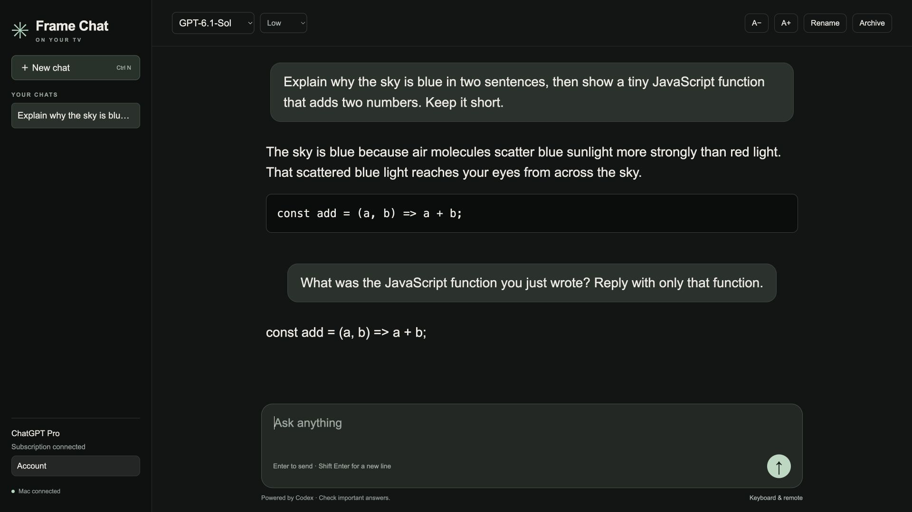

# Frame Chat

Frame Chat brings text conversations powered by Codex and a ChatGPT subscription to a Samsung Tizen TV. It includes streaming replies, Markdown and code formatting, saved chats, model selection, adjustable text size and keyboard/remote controls.

The TV runs a small web widget. A Mac on the same network runs the Codex engine already included with the ChatGPT desktop app. Keep that Mac awake while using Frame Chat.



This screenshot is from the browser preview using a real subscription response. Hardware installation and connection were verified separately on the Samsung Frame described in [compatibility](compatibility.md).

## Install

Complete [Developer Mode](developer-mode.md) and [signing](signing.md) first. Install the ChatGPT desktop app on your Mac and keep it in `/Applications/ChatGPT.app`.

```sh
npm ci

# Example addresses; replace them with your Mac and TV addresses.
export FRAME_HOST=192.168.1.10
export TV_IP=192.168.1.50
export TIZEN_STUDIO_HOME="$HOME/tizen-studio"
export SAMSUNG_SIGNING_PROFILE=MySamsungTV

npm run chat:setup
npm run chat:build
npm run chat:service:install
npm run chat:deploy
```

If Frame Terminal is already configured, setup can reuse its host and TV addresses. Frame Chat generates its own pairing keys. Its default host port is `4321`; its private browser preview is `http://127.0.0.1:4322`.

Setup looks for the Codex executable bundled with ChatGPT first. Set `FRAME_CHAT_CODEX` before initial setup to choose a different installation. An independently installed Codex CLI may work, but the tested engine was `0.163.0-alpha.10.2`, bundled with ChatGPT `26.1013.40934`. App-server protocol changes can require client updates.

## Sign in

1. Open **FrameChat** in the TV's Apps screen.
2. Select **Sign in with ChatGPT**.
3. Scan the QR code with your phone, or open the official OpenAI address shown on screen.
4. Complete your normal ChatGPT login, including any passkey or two-factor verification.
5. Enter the device code displayed on the TV.

OpenAI may require device-code sign-in to be enabled in your ChatGPT security settings. A cancelled or expired attempt can be restarted from the TV. Subscription eligibility and usage limits are controlled by OpenAI.

Frame Chat uses the [Codex app-server authentication flow](https://learn.chatgpt.com/docs/app-server#auth-endpoints). It keeps a separate login under its private data directory. Signing out of Frame Chat does not sign out the desktop app. Passwords and account tokens never enter the TV widget; Codex handles authentication and token refresh on the Mac.

The device-code and QR screen were tested through to OpenAI's passkey challenge. Completing that challenge requires the account owner's verification. Subscription inference, follow-up context and the chat interface were tested using the Mac's existing signed-in account in a separate local verification instance.

## Controls

| Action | Keyboard / remote |
| --- | --- |
| Send a message | Enter, or the send button |
| Add a line | Shift Enter |
| Start a new chat | Ctrl N, or **New chat** |
| Focus the composer | Ctrl L |
| Stop a reply | **Stop** |
| Close a dialog | Escape or remote Back |
| Move between remote controls | Back from the composer, then arrow keys and OK |
| Scroll a conversation with the remote | Focus the conversation, then Up/Down |
| Change text size | **A−** / **A+** |

Chat titles are taken from the first message. Use **Rename** to change one. **Archive** removes a chat from the TV list and keeps a recoverable copy on the Mac. Replies continue on the host if the TV disconnects; reopening a chat restores its saved text.

## What this version includes

This is a conversational client built around the Codex engine. Chats belong to Frame Chat and do not sync with ChatGPT web history. Voice, image uploads, ChatGPT plugins, computer control and filesystem tools are not included. Models and reasoning options come from the engine's available-model list; a listed model can still be unavailable to a particular subscription or workspace.

The host disables shell execution, apps, plugins and agent delegation. The assistant can explain or write code in a reply, but this client does not execute it.

## Storage and transport

The initial signed TV package was approximately **72 KiB**, with about **164 KiB** of uncompressed app files before signing metadata. Build output reports the current size. The TV stores its pairing configuration and a few preferences; conversation history lives on the Mac.

Private Mac files are under `.tools/frame-chat/`:

- `host.json` and `client.json`: paired transport configuration.
- `codex/`: separate OpenAI login and Codex session data.
- `chats.json`: UI history, names and model choices.
- `archived/`: recoverable archived chat copies.
- `device-status.json`: the latest connected-client runtime and viewport information, without conversation text.

The host limits active saved chats to 50, messages to 200 per chat, input to 16,000 characters and individual replies to 200,000 characters. It refuses new turns near its UI-history storage limits. Codex also maintains its own session database and archived histories on the Mac; archives are retained until you deliberately remove them. It does not install Electron, a model, Python or Node on the TV.

Widget traffic uses the same authenticated NaCl encryption as Frame Terminal, with separate pairing keys and replay protection. The companion accepts only configured LAN addresses. Static widget assets and their pairing credentials are served only by the loopback preview, with host-header checks. The Codex JSON-RPC process uses local stdio and is not exposed directly to the network.

Treat the paired `.wgt` as a private credential. Share the source and have each user build their own installation.

## Operate and verify

```sh
npm run chat:service:status
npm run chat:service:stop
npm run chat:start              # foreground mode, after stopping the service
npm run chat:service:install    # install or restart the login service
npm run chat:verify             # live subscription + engine restart check
```

The live verification makes two short model requests and checks that a conversation resumes after restarting the engine. It uses the Frame Chat login by default and archives its own test thread afterwards. `FRAME_CHAT_VERIFY_ACCOUNT_HOME` can select another Codex profile for an explicit local verification; it does not copy credentials.

`npm test` checks encrypted pairing, packet replay rejection, account separation, stream persistence, duplicate-send handling, interruption, archive recovery and storage bounds without calling OpenAI. CI also builds the TV bundle using disposable pairing.

For **Connecting to Mac**, check that the Mac is awake, the host service is running, the addresses still match and port `4321` is reachable. After changing the Mac's address in both private configuration files, rebuild, redeploy and restart the host.

## How the desktop app informed this implementation

The inspected macOS installation was an Electron application of roughly 1.7 GB. Its renderer communicates through an Electron preload bridge, and its resources include a separate Codex CLI/app-server engine. The tested TV reports a 32-bit ARMv7 CPU and a Chromium 120 web runtime. The desktop application and its native macOS modules cannot be copied into a Tizen widget and executed there.

Frame Chat supplies an original TV interface and uses the documented app-server interface on the Mac. It reuses the installed engine instead of redistributing the proprietary desktop application or bundling another Electron runtime. It is an unofficial personal client, not an OpenAI TV release.
